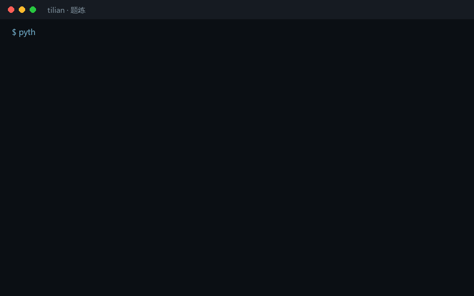
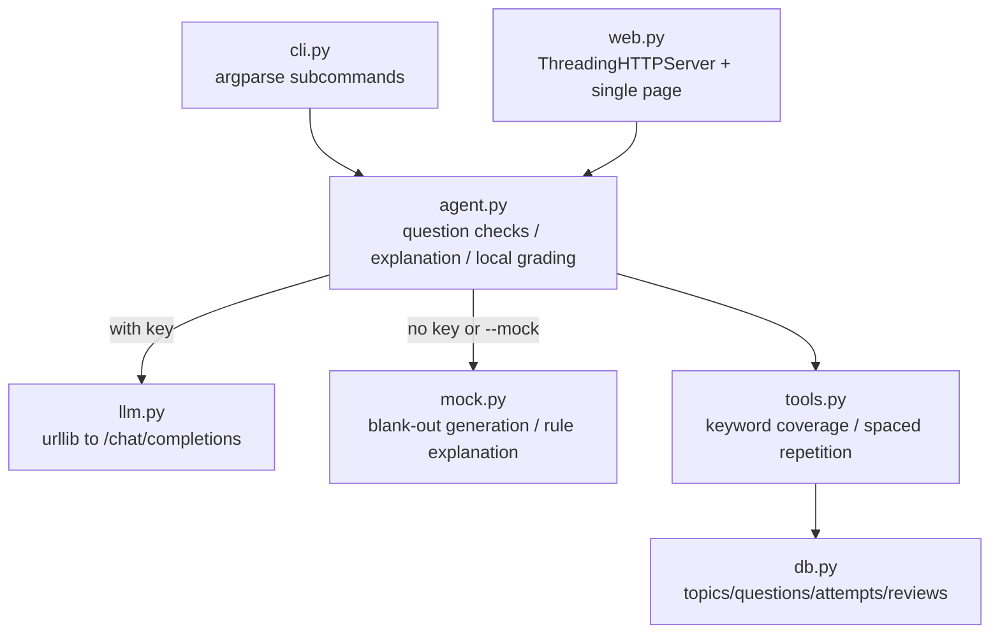

# tilian (Drill)

[](https://github.com/wushiyi105-jpg/tilian/actions)
[]()
[](./LICENSE)
[](https://codecov.io/gh/wushiyi105-jpg/tilian)



Feed it study material, get practice questions, grading, explanations and Spaced-repetition scheduling — with a wrong-answer book built in.

The least efficient study move is "read it once and feel like you know it". tilian makes you write: the model writes questions from your material, but **grading never goes to the model** — local keyword coverage decides, and half an answer counts as wrong. A wrong answer drops you back to stage zero, tomorrow.

## Features

- **Questions from material**: only your imported material, no outside knowledge; answers are blanked as `____`.
- **Leaky questions dropped**: generated questions pass a check first — if the stem contains the answer, the question is discarded and the count is reported.
- **Local grading**: identical answer passes; otherwise keyword coverage of the reference answer decides, 60% threshold with at least one keyword.
- **Explanation**: the model states the correct answer, the evidence, and which keywords you missed; if the answer is not restated, you are told to double-check.
- **Spaced repetition**: correct advances one stage (1→2→4→7→15→30 days), wrong resets to stage zero, tomorrow. Month lengths come from `calendar.monthrange`, never a hard-coded 31.
- **Wrong-answer book**: ranked by error count; `due` shows what is due today.
- **Offline mode**: generation becomes "blank out a keyword from the material" and explanations are rule-based; the blanking requires the keyword to appear exactly once in the sentence so the stem cannot leak it.
- **Two entry points**: CLI and web page.

## Quick start

```bash
git clone https://github.com/wushiyi105-jpg/tilian.git
cd tilian
python -m tilian add material.txt --topic 长期护理保险
python -m tilian gen 长期护理保险 --n 5
python -m tilian answer 1 长期照护
python -m tilian due
```

Connect a model:

```bash
cp .env.example .env
# fill LLM_API_KEY; defaults to https://api.deepseek.com + deepseek-flash
```

```bash
LLM_BASE_URL=https://open.bigmodel.cn/api/paas/v4 LLM_MODEL=glm-4.6 python -m tilian gen 长期护理保险 --n 5
```

Web:

```bash
python -m tilian web --port 8769
# http://127.0.0.1:8769
```

## Command reference

| Command | What it does |
| --- | --- |
| `add <file> --topic <name>` | Import material (at least 60 characters) |
| `topics` | Topic list |
| `gen <topic> [--n 5]` | Generate and store questions |
| `list [--topic]` | Question list |
| `show <qid>` | Stem, answer, next review |
| `answer <qid> <answer...>` | Grade and reschedule |
| `explain <qid>` | Explain the mistake |
| `due [--date]` | Questions due today |
| `wrong` | Wrong-answer ranking |
| `rm <qid>` / `stats` / `web` | Delete / stats / web |

Global switches `--mock`, `--json`, `--model`, `--base-url`, `--api-key`, `--db`.

## How it works



Three decisions:

1. **Grading is not delegated.** Asking a model to grade itself is a student marking their own paper. `tools.judge` only looks at keyword coverage — simple, stable and explainable: it tells you how many keywords you hit and which are missing.
2. **Questions must pass a compliance check.** A stem that contains the answer is discarded and counted, instead of quietly entering the bank.
3. **Scheduling is not outsourced.** The interval sequence `(1,2,4,7,15,30)` and the reset rule live locally; a plan that moves with model variance never becomes a habit.

Storage is one SQLite file with `check_same_thread=False` plus a `threading.Lock`; default `data/tilian.db`, overridable with `TILIAN_DB`.

## Layout

```
tilian/
├── tilian/
│   ├── __init__.py / __main__.py
│   ├── llm.py     # OpenAI-compatible client + .env loader
│   ├── db.py      # topics / questions / attempts / reviews
│   ├── tools.py   # grading, keywords, spaced repetition, weak points
│   ├── mock.py    # offline blank-out questions and rule explanations
│   ├── agent.py   # question checks, explanations, local grading
│   ├── cli.py     # command line
│   └── web.py     # web UI
├── data/topic-sample.json
├── tests/test_tilian.py
├── assets/demo.gif
├── .github/workflows/test.yml
├── pyproject.toml
├── README.md / README.en.md
└── CHANGELOG.md / SECURITY.md / CODE_OF_CONDUCT.md / CONTRIBUTING.md
```

## Author

shiyi · GitHub [@wushiyi105-jpg](https://github.com/wushiyi105-jpg) · wushiyi105@gmail.com

MIT License, Copyright (c) 2026 wushiyi105-jpg
