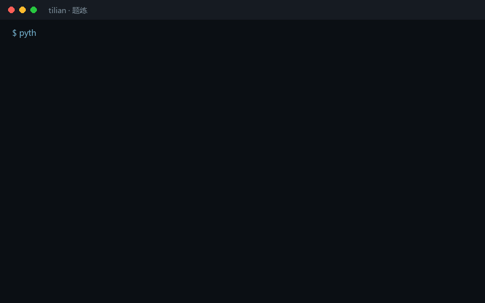
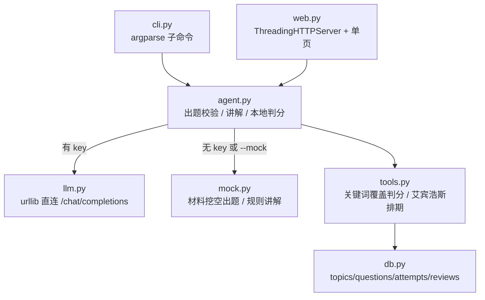

# 题练 tilian

[](https://github.com/wushiyi105-jpg/tilian/actions)
[]()
[](./LICENSE)
[](https://codecov.io/gh/wushiyi105-jpg/tilian)



给一份知识点材料,出一组练习题,判分、讲解、按艾宾浩斯排复习,错题自动记本。

备考时最没效率的动作是"看一遍,觉得自己会了"。题练逼你动笔:题目由模型照材料出,但**判分绝不给模型**——本地比对关键词覆盖,答对一半算错。答错退回第一档,明天再来。

## 功能特性

- **按材料出题**:只依据你导入的材料,不许引材料外的知识;填空题把答案挖成 `____`。
- **题干泄露直接丢**:模型出的题先过一遍检查——题干里出现答案本身,这道题作废并告诉你有几道被丢。
- **本地判分**:完全一致算对;否则按答案关键词覆盖率判,阈值 60%,至少覆盖 1 个。
- **错因讲解**:模型给讲解,先说正确答案再说依据,并点出你漏了哪个关键词;讲解里没复述答案会提示你自行核对。
- **艾宾浩斯排期**:答对进一档(1→2→4→7→15→30 天),答错退回第 0 档、明天再来。月份长度用 `calendar.monthrange`,不写死 31 天。
- **错题本**:按错误次数排序,`due` 看今天该复习哪些。
- **离线模式**:出题改为"从材料里挖空",讲解走规则;挖空时要求关键词在句中只出现一次,避免题干自带答案。
- **双入口**:CLI 与网页。

## 快速开始

```bash
git clone https://github.com/wushiyi105-jpg/tilian.git
cd tilian
python -m tilian add material.txt --topic 长期护理保险
python -m tilian gen 长期护理保险 --n 5
python -m tilian answer 1 长期照护
python -m tilian due
```

接模型:

```bash
cp .env.example .env
# 填 LLM_API_KEY,默认 https://api.deepseek.com + deepseek-flash
```

```bash
LLM_BASE_URL=https://open.bigmodel.cn/api/paas/v4 LLM_MODEL=glm-4.6 python -m tilian gen 长期护理保险 --n 5
```

网页:

```bash
python -m tilian web --port 8769
# http://127.0.0.1:8769
```

Docker 运行(容器内用默认端口 8000):

```bash
docker build -t tilian .
docker run -p 8000:8000 tilian
```

## 命令参考

| 命令 | 作用 |
| --- | --- |
| `add <file> --topic <名>` | 导入知识点材料(≥60 字) |
| `topics` | 知识点列表 |
| `gen <知识点> [--n 5]` | 出题入库 |
| `list [--topic]` | 题目列表 |
| `show <题号>` | 题干、答案、下次复习 |
| `answer <题号> <答案...>` | 判分 + 排期 |
| `explain <题号>` | 错因讲解 |
| `due [--date]` | 今天该复习的题 |
| `wrong` | 错题排行 |
| `rm <题号>` / `stats` / `web` | 删除 / 统计 / Web |

全局开关 `--mock`、`--json`、`--model`、`--base-url`、`--api-key`、`--db`。

## 🤔 为什么不用通用大模型直接问

通用模型能根据你的材料出几道题,但题练补的是它做不到的三件事:

1. **判分不归模型** —— 你答得对不对,由本地按关键词覆盖与要点比对判,模型只负责出题和讲解错因;它不能既出题又给自己打分。
2. **排期本地算** —— 艾宾浩斯间隔(1、2、4、7、15、30 天)由本地按答对答错排,答错回第一档;日期用 `calendar.monthrange` 逐月进位,不写死 31 天。
3. **错题本留在本地** —— 错题、复习时间、正确率都在本地 SQLite,不用把复习计划交给云服务。
4. **离线能练** —— 没 key 时用规则挖空出题(要求关键词唯一且足够长),讲解给要点模板,判分与排期照常。

## 🎯 适用场景

- **背知识点自测**:教材一段贴进去,出五道填空题,答完立刻判,错的那条自动进错题本。
- **考证刷题**:教资、基金从业这类要记硬知识的,按 1/2/4/7 天复习,不用自己排表。
- **讲课前检查学生掌握**:把本节要点丢进去出一组题,当堂做完当场看哪条没人答对。

## 🗺 Roadmap

- **多题型**:选择题、判断题、简答题各一套判分规则,不只填空。
- **导出复习卡**:导出 CSV,可导入 Anki 这类工具。
- **知识点掌握度**:按知识点统计正确率,指出哪一块一直不稳。
- **错题变式**:针对同一错题生成变式题,确认是真会了还是记住了答案。
- **复习提醒**:到期自动提醒今天该复习哪几条。

## ❓ FAQ

**API key 从哪来?**
出题与讲解要模型,默认接 DeepSeek 或智谱都行,填 `.env` 的 `LLM_API_KEY`;判分与排期不需要。

**数据存在哪,会上传吗?**
题目、作答、错题本在本地 SQLite;调模型时只发当前这段材料和题目。

**没有 key 能不能用?**
能,挖空出题、判分、排期全本地;讲解是模板,不如模型细。

**怎么换模型?**
改 `LLM_BASE_URL`、`LLM_MODEL`、`LLM_API_KEY`,见 `.env.example`。

**为什么判分不是你说了算?**
因为它要能复核。关键词覆盖不到阈值就算错,错在哪几个要点列出来;想放宽可以看输出里的覆盖明细再决定。

## 工作原理



三处取舍:

1. **判分权不下放**。让模型给自己判分,等于让学生自己打卷。`tools.judge` 只看关键词覆盖,规则简单但结果稳定、可解释——它会告诉你覆盖了几个、缺哪几个。
2. **题目必须过合规检查**。题干里含答案(比如"长期护理保险管的是____"这类看似合理实则泄题的句子)一律丢,并统计丢弃数量,而不是悄悄混进题库。
3. **排期不外借**。间隔序列 `(1,2,4,7,15,30)` 与"答错归零"的规则写在本地,模型不参与——计划一旦受模型波动影响,复习节奏就没法建立。

SQLite 单文件,`check_same_thread=False` + `threading.Lock`,默认 `data/tilian.db`,`TILIAN_DB` 可改。

## 目录结构

```
tilian/
├── tilian/
│   ├── __init__.py / __main__.py
│   ├── llm.py     # OpenAI 兼容客户端 + .env 加载
│   ├── db.py      # topics / questions / attempts / reviews
│   ├── tools.py   # 判分、关键词、艾宾浩斯排期、错题统计
│   ├── mock.py    # 离线挖空出题与规则讲解
│   ├── agent.py   # 出题校验、讲解、本地判分
│   ├── cli.py     # 命令行
│   └── web.py     # Web UI
├── data/topic-sample.json
├── tests/test_tilian.py
├── assets/demo.gif
├── .github/workflows/test.yml
├── pyproject.toml
├── README.md / README.en.md
└── CHANGELOG.md / SECURITY.md / CODE_OF_CONDUCT.md / CONTRIBUTING.md
```

## 作者

大钊 · 17382987315

MIT License,Copyright (c) 2026 wushiyi105-jpg
